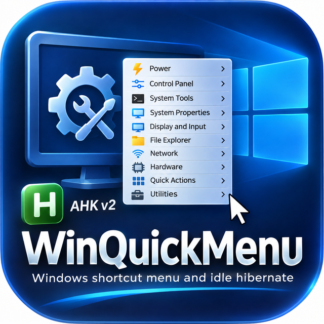

# WinQuickMenu

<p align="center"></p>

**One popup menu for the Windows tools you can never find — plus an idle-hibernate timer that actually works.**

WinQuickMenu is a small AutoHotkey v2 utility that puts 70 Windows settings pages, admin tools, folders and power actions into a single menu. Every item also has a short **hotstring** — type it anywhere and the tool opens. The menu shows each hotstring in parentheses, so you learn them just by using it.

It also includes an optional **idle hibernate** watcher that hibernates the PC after a set time with no keyboard or mouse input — even when remote-access tools, audio drivers or other apps are quietly keeping Windows awake.

- No installation required — download the `.exe` and run it
- Or run the `.ahk` script directly if you have AutoHotkey v2
- Windows 10 and Windows 11
- Free and open source (MIT License)

---

## Download

Go to the [**Releases**](https://github.com/smogmanus1/WinQuickMenu/releases) page and download `WinQuickMenu.exe`. Put it in any folder you like (for example `Documents\WinQuickMenu`) and double-click it.

You'll see a green **H** icon in the system tray. That's it — it's running.

> **Windows SmartScreen / antivirus warning:** small unsigned programs built with AutoHotkey are sometimes flagged as "unrecognized." This is a known false positive with AutoHotkey-compiled programs. The full source code is in this repository, and the `.exe` is built automatically from it by GitHub Actions (see `.github/workflows/build.yml`), so you can verify exactly what it contains. If you prefer, install [AutoHotkey v2](https://www.autohotkey.com/) and run `WinQuickMenu.ahk` instead.

### Start automatically with Windows

1. Press **Win + R**, type `shell:startup`, press Enter.
2. Right-click `WinQuickMenu.exe` → **Show more options** → **Create shortcut**.
3. Move that shortcut into the Startup folder that opened.

(Once WinQuickMenu is running you can also type `startupp` to open the Startup folder.)

---

## How to use it

| To do this | Do this |
|---|---|
| Open the menu | Type **`rdmenu`** anywhere, or **double-click the tray icon**. It opens in the top-right corner of the screen. |
| Keep the menu on screen | Type **`rdpin`** for a small always-on-top panel in the top-right corner. Search, double-click to run. Type `rdpin` again or press Esc to close. |
| Run a command without the menu | Type its hotstring, then press **Space** or **Enter** |
| Turn idle hibernate on/off | Type **`hibpause`**, or use **Power → Idle hibernate** in the menu |
| Check idle hibernate status | Type **`hibstat`** |
| Change settings | Tray icon → **Open settings file** |

Hotstrings work in any window — a text box, Notepad, the desktop. When you type one, the letters you typed are erased and the command runs.

Most hotstrings need an **ending key** (Space, Enter, Tab or punctuation) to fire. The four control hotstrings — `rdmenu`, `rdpin`, `hibpause` and `hibstat` — fire as soon as you finish typing them.

**Why do some hotstrings end in "p"?** Names like `regedit`, `taskmgr` or `logoff` are real Windows commands. If the hotstring had the same name, typing `logoff` in a terminal would sign you out. Adding a `p` (for "pop-up") avoids those collisions: `regeditp`, `taskmgrp`, `logoffp`.

---

## Idle hibernate

Windows has a built-in "Hibernate after" timer, but it often never fires. That's because any program can send Windows a **power request** that says "don't go idle" — and many do:

- Remote-access tools (RemotePC, TeamViewer, AnyDesk, etc.)
- Audio drivers when any sound stream is open — even a silent one, such as HDMI audio to a monitor
- Browsers, chat apps, and Electron apps (Discord, Slack, many AI desktop apps)
- Backup and sync tools

You can see what's blocking your PC by opening Terminal (Admin) and running `powercfg /requests`.

WinQuickMenu takes a different approach: it watches **actual keyboard and mouse activity** and, after the time you set, tells Windows to hibernate directly. Power requests can't block it.

**How it behaves:**

- It is **off by default**. Turn it on with `hibpause` or from the Power menu. Your choice is saved.
- A tooltip warns you before it hibernates (2 minutes by default). Touch the mouse or keyboard to cancel.
- Waking from hibernate restarts the idle clock, so the PC won't immediately hibernate again.
- Audio or video playing does **not** count as activity. If you're watching a long movie without touching anything, type `hibpause` first.
- Every hibernate and resume is written to `WinQuickMenu.log` next to the program.

**Hibernate vs. sleep:** hibernate saves everything in memory to the drive and powers the PC completely off. Your open programs and documents come back exactly as you left them, even if the power goes out while it's hibernated. Sleep keeps memory powered, so a power outage during sleep loses unsaved work.

**If you use remote access:** a hibernated PC can't be reached remotely until someone presses the power button. Leave idle hibernate off on any PC you need to reach from away.

**If nothing happens:** hibernate may be disabled on your PC. Open Terminal (Admin) and run:
```
powercfg /hibernate on
```

---

## Settings

Settings are stored in `WinQuickMenu.ini` in the same folder as the program. It's created on first run. Open it from the tray menu → **Open settings file**, edit, save, then tray menu → **Reload**.

```ini
[IdleHibernate]
Enabled=0        ; 1 = on, 0 = off (hibpause toggles this)
Minutes=90       ; minutes of no input before hibernating (minimum 5)
WarnMinutes=2    ; minutes of warning tooltip before hibernating (0 = no warning)

[Menu]
Position=TopRight   ; where rdmenu opens: TopRight, TopLeft or Mouse
```

The menu opens in the top-right corner of whichever monitor your mouse is on. Set `Position=Mouse` to have it pop up at the mouse pointer instead.

> If you put the program in a protected folder such as `C:\Program Files`, it can't save settings or its log there. Use a folder in your user profile instead.

---

## Command reference

Every command, its hotstring, and what it does.

### Power

| Hotstring | Menu item | What it does |
|---|---|---|
| `sdnow` | Shut down now | Shuts down Windows immediately. Programs with unsaved work get a chance to ask you to save. |
| `restpc` | Restart now | Restarts Windows immediately. |
| `hibnow` | Hibernate now | Saves everything to disk and powers off. Use it when you know you're leaving. Press the power button to pick up exactly where you left off. |
| `sleepnow` | Sleep now | Puts the PC into sleep (low-power, memory stays on). On PCs that don't support sleep, Windows hibernates instead. |
| `screenlock` | Lock screen | Locks the PC to the sign-in screen. Same as **Win + L**. |
| `logoffp` | Sign out | Signs you out of Windows, closing your programs. |
| `sd1hr` | Shut down in 1 hour | Schedules a shutdown 60 minutes from now. Handy before bed or when a long download is running. |
| `sdcancel` | Cancel scheduled shutdown | Cancels a shutdown scheduled with `sd1hr` (or any `shutdown /t` timer). |
| `hibpause` | Idle hibernate after N min | Turns the idle-hibernate watcher on or off. A checkmark in the menu shows when it's on. |
| `hibstat` | Idle hibernate status | Shows whether idle hibernate is on, the time limit, how long the PC has been idle, and where the settings and log files are. |

### Control Panel

| Hotstring | Menu item | What it does |
|---|---|---|
| `cpcp` | Control Panel | Opens the classic Control Panel. |
| `addremove` | Programs and Features | Opens the classic uninstall list. Shows install dates and sizes, and lists older programs the Settings app sometimes misses. |
| `datetimep` | Date and Time | Opens the classic Date and Time window: time zone, additional clocks, and internet time sync. |
| `devmgrp` | Device Manager | Lists every piece of hardware. Use it to update or roll back drivers and find devices with problems (yellow warning icons). |
| `powerprop` | Power Options | Opens power plans, where you can choose a plan and change what the power button and lid do. |
| `reglang` | Region and Language | Opens date, time, number and currency formats. |
| `useracc` | User Accounts | Opens the classic User Accounts panel: account type, name, and credential manager links. |
| `sysupdate` | Windows Update | Opens Windows Update in Settings. |
| `godmode` | God Mode (all settings) | Creates a special "God Mode" folder on your desktop that lists 200+ Windows settings in one place, then opens it. |

### System Tools

| Hotstring | Menu item | What it does |
|---|---|---|
| `taskmgrp` | Task Manager | See and end running programs, check CPU/memory/disk use, and manage startup apps. |
| `resmonp` | Resource Monitor | A more detailed view than Task Manager: which program is using the disk, network, or a specific file. |
| `eventview` | Event Viewer | Windows' system logs. Use it to find out why a PC crashed, restarted, or woke up overnight. |
| `servicesprog` | Services | Start, stop, or disable background Windows services. |
| `tasksched` | Task Scheduler | Create or review programs that run on a schedule or at startup. |
| `compmgmtp` | Computer Management | One window combining Event Viewer, Services, Disk Management, Device Manager, users, and shared folders. |
| `diskmgmtp` | Disk Management | See all drives and partitions; assign drive letters, format, or initialize new drives. |
| `diskclean` | Disk Cleanup | Frees space by removing temporary files, old update files, and thumbnails. |
| `sysinfo` | System Information | Full hardware and software details: model, BIOS version, RAM, drivers. |
| `regeditp` | Registry Editor | Opens the Windows Registry. Be careful: wrong changes here can break Windows. |
| `idletask` | Run idle maintenance tasks | Tells Windows to run the maintenance it normally saves for idle time (indexing, cleanup) right now. |

### System Properties

| Hotstring | Menu item | What it does |
|---|---|---|
| `sysprop` | Computer name / domain | Rename the PC or join a workgroup/domain. |
| `sysadvance` | Advanced | Performance options (visual effects, virtual memory), startup and recovery, and **environment variables**. |
| `sysprotect` | System Protection | Turn on System Restore, create a restore point, or roll back to one. |
| `sysremote` | Remote settings | Turn Remote Desktop and Remote Assistance on or off. |
| `winabout` | About Windows | Shows your exact Windows version and build number. |
| `winsec` | Windows Security | Opens Windows Security: virus protection, firewall status, device security. |

### Display and Input

| Hotstring | Menu item | What it does |
|---|---|---|
| `displayset` | Display settings | Resolution, scaling, orientation, and multiple monitors. |
| `screenres` | Screen resolution (classic) | The classic display shortcut. On Windows 10/11 it opens Display settings. |
| `nightlight` | Night light | Warmer screen colors in the evening to reduce blue light. |
| `taskprop` | Taskbar settings | Taskbar alignment, icons, and auto-hide. |
| `mouseprop` | Mouse properties | Pointer speed, double-click speed, button swap, pointer shapes. |
| `kbprop` | Keyboard properties | Key repeat delay and rate, cursor blink rate. |
| `soundprop` | Sound devices | The classic Sound window: choose default speakers/microphone, set levels, and disable devices. |
| `handycap` | Accessibility | Text size, magnifier, color filters, narrator, and other accessibility options. |

### File Explorer

| Hotstring | Menu item | What it does |
|---|---|---|
| `folderop` | Folder Options – General | How File Explorer opens, single vs. double click, privacy (recent files). |
| `folderset` | Folder Options – View | Show hidden files, show file extensions, and other view settings. |
| `foldersetting` | Folder Options – Search | How File Explorer searches (file contents, system folders, compressed files). |
| `filetypep` | Default apps / file types | Choose which program opens each file type. |

### Network

| Hotstring | Menu item | What it does |
|---|---|---|
| `netprop` | Network Connections | The classic adapter list. Use it to set a static IP, disable an adapter, or check adapter status. |
| `netreset` | Network status | Network status page in Settings, including **Network reset** and troubleshooters. |
| `wifiset` | Wi-Fi settings | Manage Wi-Fi networks and saved networks. |
| `mapdrive` | Map Network Drive | Connect a shared folder on another PC or NAS as a drive letter. |
| `winfw` | Windows Firewall | Classic firewall panel: allow apps through, turn the firewall on or off, advanced rules. |
| `ieprop` | Internet Options | Classic internet settings: proxy, security zones, and connection settings still used by many programs. |
| `flushdns` | Flush DNS cache | Clears Windows' DNS cache. Try this when a website won't load or a domain has just moved to a new server. |

### Hardware

| Hotstring | Menu item | What it does |
|---|---|---|
| `ejectdev` | Safely Remove Hardware | Opens the safe-removal window for USB drives and other removable devices. |
| `prman` | Printers and scanners | Add, remove, or manage printers and scanners. |

### Quick Actions

| Hotstring | Menu item | What it does |
|---|---|---|
| `emptybin` | Empty Recycle Bin | Permanently deletes everything in the Recycle Bin (asks first). |
| `downloadsp` | Downloads folder | Opens your Downloads folder. |
| `startupp` | Startup folder | Opens your Startup folder. Shortcuts placed here run when you sign in. |
| `tempfolder` | Temp folder | Opens your temporary files folder. Safe to delete old files here when programs are closed. |
| `snipp` | Snipping Tool | Opens the Snipping Tool app. |
| `prtsc` | Screen snip | Starts a screen capture right away. Same as **Win + Shift + S**. |
| `calcp` | Calculator | Opens Calculator. |
| `notepadp` | Notepad | Opens Notepad. |
| `paintp` | Paint | Opens Paint. |
| `clipclear` | Clear clipboard | Empties the clipboard, so whatever you copied last (like a password) can't be pasted by accident. |
| `cliphist` | Clipboard history | Opens Windows clipboard history. Same as **Win + V**. |

### Utilities

| Hotstring | Menu item | What it does |
|---|---|---|
| `storedpass` | Stored user names and passwords | The classic credential manager for saved network and server logins. |
| `winfont` | Fonts folder | Opens the Windows Fonts folder to view, install, or remove fonts. |

### Menu controls

| Hotstring | What it does |
|---|---|
| `rdmenu` | Opens the WinQuickMenu popup menu (top-right corner by default; see Settings). |
| `rdpin` | Opens or closes the pinned panel: an always-on-top window listing every command, with a search box. Double-click or press Enter to run. It remembers where you drag it, and reopens at startup if you left it open. |

---

## Running from source

1. Install [AutoHotkey v2](https://www.autohotkey.com/).
2. Download `WinQuickMenu.ahk` from this repository.
3. Double-click it.

### Building the EXE yourself

With AutoHotkey v2 installed (it includes the Ahk2Exe compiler), double-click `build.cmd`. It creates `WinQuickMenu.exe` in the same folder.

Release builds are made automatically: pushing a version tag (for example `v1.0.0`) runs the GitHub Actions workflow, which compiles the script on a clean Windows machine and attaches `WinQuickMenu.exe` to the release.

### Adding your own commands

All commands live in the `Commands` table near the top of `WinQuickMenu.ahk`. Each line is:

```autohotkey
["Category", "Menu label", "hotstring", "command to run"],
```

The command can be anything `Run` accepts — a program, an `.msc` console, a `control` panel, an `ms-settings:` page, a `shell:` folder — or the name of a function in the script. Add a line, save, and reload; the menu item and hotstring are created automatically.

---

## License

MIT License — see [LICENSE](LICENSE). Free to use, modify, and share.

Created by Brad Schrunk.
